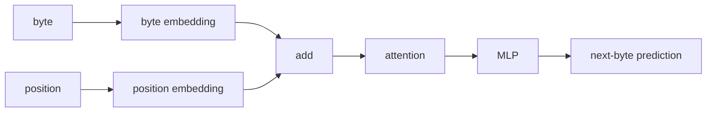
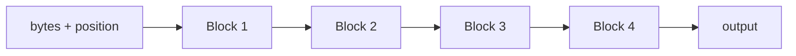

py -m venv .venv
.venv\Scripts\activate.ps1
pip install torch==2.13.0 --index-url https://download.pytorch.org/whl/cu132
pip install numpy
pip install datasets

#verify
python -c "import torch; print(torch.__version__); print(torch.version.cuda); print(torch.cuda.get_device_name(0)); print(torch.cuda.is_available())"

# design



use more transformers



# run

```
> python main.py
0: train loss=5.7241
2000: train loss=2.2621
4000: train loss=1.8558
6000: train loss=1.8039
8000: train loss=1.7516
10000: train loss=1.7851
12000: train loss=2.1371
14000: train loss=1.2514
16000: train loss=1.3470
18000: train loss=1.3974

Parameters:      867,328
Training time:   140.86s
Peak VRAM:       32.9 MB
Steps/sec:       142.0
Validation loss: 1.2925

Once upon a time, there was a big boy named Lily. She was so happy to the started to the started to the started to the started to the started to the started to the started to the started to thestarted to the started
```
