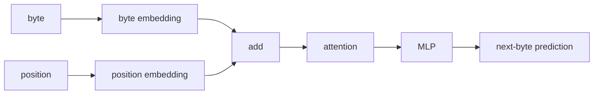

py -m venv .venv
.venv\Scripts\activate.ps1
pip install torch==2.13.0 --index-url https://download.pytorch.org/whl/cu132
pip install numpy

#verify
python -c "import torch; print(torch.__version__); print(torch.version.cuda); print(torch.cuda.get_device_name(0)); print(torch.cuda.is_available())"

# design



# run

```
python main.py
0: loss=5.7110
100: loss=1.2990
200: loss=0.9398
300: loss=0.7961
400: loss=0.6090
500: loss=0.4653
600: loss=0.2785
700: loss=0.2281
800: loss=0.2786
900: loss=0.2300
the cat likes milk.
the dog likes food.
the cat sat on the milk.
the dog sat sathe og sat sat on the t the
```
