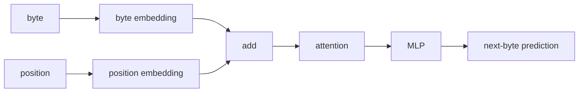
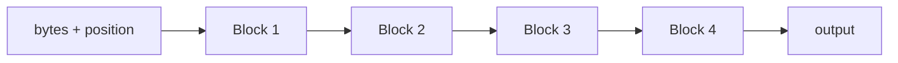

py -m venv .venv
.venv\Scripts\activate.ps1
pip install torch==2.13.0 --index-url https://download.pytorch.org/whl/cu132
pip install numpy
pip install datasets

#verify
python -c "import torch; print(torch.__version__); print(torch.version.cuda); print(torch.cuda.get_device_name(0)); print(torch.cuda.is_available())"

# design



use more transformers



# run

Runs are from top to bottom. With the modified params as mentioned.
All other params stay as the previous best run if not specified otherwise.

## simple recursion
```
This is a useful result.
Model	Params	VRAM	Time	Val loss
4 unique blocks	867,328	32.9 MB	140.9 s	1.2925
1 shared block ×4	272,512	23.0 MB	141.0 s	1.4159


So recurrence gave us:
- ~69% fewer parameters
- ~30% less VRAM
- essentially identical training speed
- only ~0.12 worse validation loss
That is actually promising.
```

## 2 blocks each used 2 times

```
So compared with 4 unique blocks, A→B→A→B uses about 46% fewer parameters and ~21% less VRAM, while validation loss only worsens from 1.2925 to 1.3403.

The repetitive generation is still a weakness, but that affects all these tiny models.
```

## 2 blockes each used 3 times

| Model | Params | VRAM | Time | Val loss |
|---|---:|---:|---:|---:|
| 4 unique blocks | 867k | 32.9 MB | 141 s | **1.2925** |
| A→B ×2 | 471k | 26.0 MB | 139 s | 1.3403 |
| **A→B ×3** | **471k** | **27.2 MB** | **195 s** | **1.3039** |
| A ×4 | 273k | 23.0 MB | 141 s | 1.4159 |

I wouldn't worry much about the repetitive generated text yet. We're using greedy argmax, only 64 bytes of context, and a ~0.5M parameter model.

## 2 blocks each 4 times

| Model | Params | Time | VRAM | Val loss |
|---|---:|---:|---:|---:|
| A→B ×3 | 470,784 | 194.8s | 27.2 MB | **1.3039** |
| A→B ×4 | 470,784 | 248.0s | 28.4 MB | 1.3072 |

## context=128 instead of 64

| Model | Context | Val loss | Time | VRAM |
|---|---:|---:|---:|---:|
| A→B ×3 | 64 | 1.3039 | 194.8s | 27.2 MB |
| A→B ×3 | 128 | **1.2649** | 189.7s | 31.8 MB |

## context=256 instead of 64

The next thing I’d test is context 256 before touching experts or anything more complex. This experiment strongly suggests the model is still context-limited.

| Context | Val loss | VRAM | Time |
|---:|---:|---:|---:|
| 64 | 1.3039 | 27.2 MB | 194.8s |
| 128 | **1.2649** | 31.8 MB | 189.7s |
| 256 | **1.2619** | 43.5 MB | 195.5s |

So 128 → 256 gives only 0.003 better loss but costs ~37% more VRAM.
I’d keep context 128 as the better efficiency point.

## context=128, dim=256, recurrent_steps=3

| Model | Params | VRAM | Val loss |
|---|---:|---:|---:|
| dim 128, ctx 128, A→B ×3 | 479k | 31.8 MB | 1.2649 |
| **dim 256, ctx 128, A→B ×3** | **1.74M** | **57.7 MB** | **1.1105** |

## context=128, dim=384, recurrent_steps=3

This is another clear gain.
| dim | Params | VRAM | Val loss |
|---:|---:|---:|---:|
| 128 | 479k | 31.8 MB | 1.2649 |
| 256 | 1.74M | 57.7 MB | 1.1105 |
| **384** | **3.80M** | **99 MB** | **1.0384** |


And the generated text is much more coherent now.
The important pattern so far:
Wider model capacity is buying much more quality than longer context or extra recurrent passes.

You still have enormous VRAM headroom, so I’d test dim=512, context=128, recurrent_steps=3 next.
That should tell us whether the gains continue or start flattening.

## context=128, dim=512, recurrent_steps=3

| dim | Params | VRAM | Val loss |
|---:|---:|---:|---:|
| 256 | 1.74M | 57.7 MB | 1.1105 |
| 384 | 3.80M | 99.0 MB | **1.0384** |
| 512 | 6.63M | 150.3 MB | **1.0321** |

## dim=384, context=128, recurrent_steps=2, blocks=3

| Design | Params | VRAM | Val loss |
|---|---:|---:|---:|
| 2 blocks ×3, dim 384 | 3.80M | 99 MB | 1.0384 |
| 3 blocks ×2, dim 384 | 5.57M | 126 MB | **1.0097** |
| 2 blocks ×3, dim 512 | 6.63M | 150 MB | 1.0321 |

So adding more unique blocks helped more than just increasing width.
The generation also looks cleaner.
That suggests our current bottleneck is more likely unique model capacity, not extra recurrent depth.

## dim=384, context=128, recurrent_steps=1, blocks=4

That gives only 4 block applications instead of 6, but more unique parameters. It will tell us whether recurrence is actually buying us anything at this scale.

| Design | Params | Block applications | Time | VRAM | Val loss |
|---|---:|---:|---:|---:|---:|
| 3 unique ×2 | 5.57M | 6 | 218.6s | 126 MB | **1.0097** |
| 4 unique ×1 | 7.34M | 4 | 173.3s | 158 MB | 1.0239 |

So the 3×2 model is:
- ~24% fewer parameters
- ~20% less VRAM
- slightly better validation loss
- but ~26% slower

For your RTX 3060, that trade is attractive because we have much more compute headroom than VRAM pressure.
I’d keep 3 unique blocks ×2 as our current baseline.
The next thing I’d change is probably the training setup rather than architecture: use a batch larger than 1. Right now each update learns from only one 128-byte sequence, which makes those training-loss numbers jump around a lot and wastes GPU parallelism.

## change impl to use random chunks=32

But look at throughput
Old 3 blocks ×2 run:
~2.56M bytes / 218.6 s
≈ 11,700 bytes/sec

Batch-32:
62,348 bytes/sec

That's about 5.3× more training throughput.
And you're only using:
745 MB / 12 GB VRAM

So batching is definitely the right direction.

I'd now keep:
batch_size = 32
context = 128
dim = 384
recurrent_steps = 2

steps = 5000

And from now on, we should keep batch size fixed when comparing architectures. That will make the experiments much cleaner.

One other useful observation: your training loss with batch 32 is beautifully smooth

## ctx=128, batch_size=32, steps=5000, recur=2, 3 blocks, dim=384

| Setup | Training bytes | Time | Val loss |
|---|---:|---:|---:|
| batch 1 | 2.56M | 218.6s | 1.0097 |
| batch 32 | 20.48M | 328.6s | **0.8539** |

The generated text is also much better:
“Once upon a time, there was a little girl named Lily. She loved to play outside in the garden...”

That’s now coherent enough that architecture comparisons become more meaningful.
The next thing I’d do is not change the architecture yet. Keep this exact setup and add checkpointing + periodic validation, for example every 500 steps, so we can see whether the model is still improving at 5000 or already starting to plateau.

## ctx=128, batch_size=32, steps=5000, recur=2, 3 blocks, dim=384 + add checkpointing + periodic validation

looks good, continuus improvment

### same setup but 10000 steps of training

This looks good, and now we can see the curve starting to flatten.
Key points:
- Best validation loss improved from 0.8570 at 5k steps to 0.7820 at 9.5k.
- Improvement after ~8k is much slower.
- 10k is slightly worse than 9.5k, so saving the best checkpoint was useful.
- Generation is much more coherent than before.
So I would not just keep training this exact setup indefinitely.
Best next experiment: keep the same model and training setup, but increase the dataset from train[:1%] to maybe train[:5%].

why: current model has now seen ~41M sampled bytes
training corpus only contains ~19M unique bytes

## %5 trainig set

Interesting: using 5% training data produced almost the same validation loss as 1%.
1% data: best val ≈ 0.7820
5% data: best val ≈ 0.7826

So at this training budget, data diversity is not the bottleneck. The model itself/training setup is now the stronger candidate.

I’d do them in this order, one at a time:
1. LayerNorm -> RMSNorm
2. GELU MLP -> SwiGLU
3. learned positional embeddings -> RoPE
4. then compare recurrence patterns again

## LayerNorm -> RMSNorm
RMSNorm is essentially a wash here:
| Norm | Params | Time | VRAM | Best val |
|---|---:|---:|---:|---:|
| LayerNorm | 5,570,176 | 679.3s | 745.4 MB | 0.7826 |
| RMSNorm | 5,567,488 | 671.8s | 745.2 MB | **0.7821** |

So: tiny improvement in speed/params, quality basically unchanged.
That means RMSNorm is reasonable to keep, but it’s not a breakthrough.
Next I’d test SwiGLU instead of the current GELU MLP. That changes the feed-forward part, which is a bigger architectural change and may matter more.

## GELU MLP -> SwiGLU

The flow changes from: Linear → GELU → Linear
to:
        ┌→ gate → SiLU ─┐
input ──┤               × → down → output
        └→ up ──────────┘

SwiGLU is a real win here.

| MLP | Params | Time | VRAM | Best val |
|---|---:|---:|---:|---:|
| GELU | 5.57M | 671.8s | 745 MB | 0.7821 |
| **SwiGLU** | 5.56M | 695.6s | 845 MB | **0.7463** |

So you gained about 4.6% lower validation loss for roughly the same parameter count, at the cost of ~13% more VRAM and slightly slower training.
The generation sample also looks noticeably cleaner.

## Use RoPE

updated tinylm.py with RoPE. I replaced nn.MultiheadAttention with a small custom attention module so we can rotate Q/K directly.

before:
token embedding + learned position embedding
                    ↓
                 attention

now:
token embedding
     ↓
Q/K generated
     ↓
RoPE rotates Q/K based on position
     ↓
attention

RoPE is another real improvement.

| Position method | Params | Time | VRAM | Best val |
|---|---:|---:|---:|---:|
| Learned positions | 5.56M | 695.6s | 845 MB | 0.7463 |
| **RoPE** | **5.51M** | **658.0s** | 873 MB | **0.7280** |

So RoPE gave us:
- ~2.5% lower validation loss
- slightly fewer parameters
- faster training
- slightly more VRAM
- cleaner generation

## heads=4 -> heads 6

The next architecture experiment I’d do is number of attention heads, because with dim=384, heads=4 means each head is quite large:
384 / 4 = 96 dimensions per head

I’d test heads=6 next:
384 / 6 = 64 dimensions per head

That’s a very common head size and gives attention more independent channels without changing the overall model width much.

| Heads | Head dim | Time | Best val |
|---:|---:|---:|---:|
| 4 | 96 | 658s | 0.7280 |
| **6** | **64** | **629s** | **0.7222** |

Same parameter count and VRAM, but slightly better quality and faster training. So I’d keep 6 heads.

Best as of now with 10000 training steps, random batches

```
dim=384
heads=6
context=128
3 unique blocks × 2 recurrent passes
RMSNorm
SwiGLU
RoPE
```

## context=256

This is a strong result. Context 256 is clearly worthwhile now.
More importantly, we can compare fairly by bytes seen, not just steps:

| Setup | Bytes seen | Approx. time | Val loss |
|---|---:|---:|---:|
| ctx 128, 10k steps | 40.96M | 629s | 0.7222 |
| **ctx 256, 5k steps** | **40.96M** | ~635s | **0.6942** |

10k steps val loss = 0.6338

dim = 384
heads = 6
context = 256

3 unique blocks
× 2 recurrent passes

RMSNorm
SwiGLU
RoPE

5.51M parameters
~1.66 GB peak VRAM

# dim = 512

This is better quality, but much less efficient.

| Model | Params | VRAM | Time | Best val |
|---|---:|---:|---:|---:|
| dim 384, ctx 256 | 5.51M | 1.66 GB | 1270s | 0.6338 |
| dim 512, ctx 256 | 9.70M | 2.23 GB | 2075s | **0.6109** |

So widening to 512 gives about 3.6% lower validation loss, but costs:
- ~76% more parameters
- ~35% more VRAM
- ~63% more training time
That suggests dim=384 is still the better efficiency point, while 512 is better if we only care about quality.

```
same dim=384
same context=256
same 3 blocks ×2

dense SwiGLU
        vs
MoE SwiGLU
```

e.g.
8 experts total
top-2 experts active per position

goal: increase total model capacity without increasing active computation anywhere near as much as widening the whole model. -> That is much closer to the architecture direction we actually care about for a 12 GB GPU.

# last tests output

Note: for more output see git history.

```
python main.py
Device:     cuda
Context:    256
Batch size: 32
Steps:      10000
Validate every x steps: 500
Validate batches:       20
Transform Layers:       3
Target Dimensions:       64
Dim=512, Heads=8, Recurrent Steps=2

Loading training data...
Training bytes: 93,815,188
Loading validation data...
Validation bytes: 187,001

Parameters: 9,701,632

    500: train=1.0363  val=0.9962
       saved best_model.pt
   1000: train=0.8940  val=0.8670
       saved best_model.pt
   1500: train=0.8740  val=0.8009
       saved best_model.pt
   2000: train=0.8010  val=0.7817
       saved best_model.pt
   2500: train=0.7810  val=0.7424
       saved best_model.pt
   3000: train=0.7980  val=0.7353
       saved best_model.pt
   3500: train=0.7601  val=0.7189
       saved best_model.pt
   4000: train=0.8033  val=0.6972
       saved best_model.pt
   4500: train=0.7161  val=0.6787
       saved best_model.pt
   5000: train=0.7368  val=0.6761
       saved best_model.pt
   5500: train=0.7100  val=0.6672
       saved best_model.pt
   6000: train=0.6847  val=0.6546
       saved best_model.pt
   6500: train=0.7019  val=0.6593
   7000: train=0.6966  val=0.6493
       saved best_model.pt
   7500: train=0.6853  val=0.6487
       saved best_model.pt
   8000: train=0.7357  val=0.6370
       saved best_model.pt
   8500: train=0.6893  val=0.6222
       saved best_model.pt
   9000: train=0.7257  val=0.6228
   9500: train=0.6766  val=0.6109
       saved best_model.pt
  10000: train=0.6475  val=0.6130
Saved last_model.pt

------------------------------
Results
------------------------------
Parameters:      9,701,632
Training bytes:  81,920,000
Training time:   2074.53s
Peak VRAM:       2227.9 MB
Bytes/sec:       39,489
Best val loss:   0.6109
Using checkpoint from step 9500 (val=0.6109)

------------------------------
Generation
------------------------------

Once upon a time, there was a little girl named Lily. She loved to play outside in the sunshine. One day, she saw a big building with a big box of toys. Shewanted to play with it too, but it was too high.

Lily was
```
