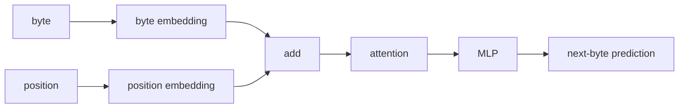
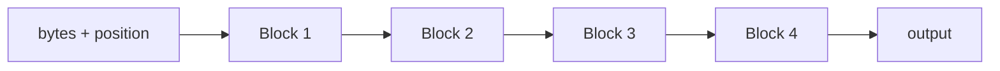

py -m venv .venv
.venv\Scripts\activate.ps1
pip install torch==2.13.0 --index-url https://download.pytorch.org/whl/cu132
pip install numpy

#verify
python -c "import torch; print(torch.__version__); print(torch.version.cuda); print(torch.cuda.get_device_name(0)); print(torch.cuda.is_available())"

# design



use more transformers



# run

```
python main.py
0: loss=5.7992
100: loss=0.9663
200: loss=0.8042
300: loss=0.4229
400: loss=0.2531
500: loss=0.1092
600: loss=0.1075
700: loss=0.1189
800: loss=0.0412
900: loss=0.1080
the cat likes milk.
the dog likes food.

the cat sat on the mat.
the dog sat on the flooor.
the cat likes m
```
