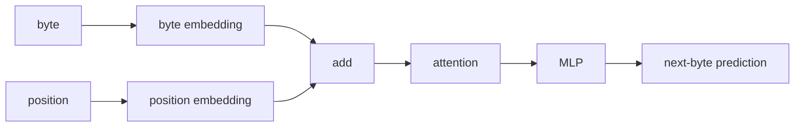
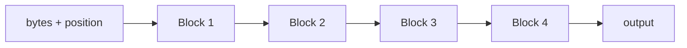

py -m venv .venv
.venv\Scripts\activate.ps1
pip install torch==2.13.0 --index-url https://download.pytorch.org/whl/cu132
pip install numpy
pip install datasets

#verify
python -c "import torch; print(torch.__version__); print(torch.version.cuda); print(torch.cuda.get_device_name(0)); print(torch.cuda.is_available())"

# design



use more transformers



# run

## simple recursion
```
This is a useful result.
Model	Params	VRAM	Time	Val loss
4 unique blocks	867,328	32.9 MB	140.9 s	1.2925
1 shared block ×4	272,512	23.0 MB	141.0 s	1.4159


So recurrence gave us:
- ~69% fewer parameters
- ~30% less VRAM
- essentially identical training speed
- only ~0.12 worse validation loss
That is actually promising.
```

## 2 blocks each used 2 times

```
So compared with 4 unique blocks, A→B→A→B uses about 46% fewer parameters and ~21% less VRAM, while validation loss only worsens from 1.2925 to 1.3403.

The repetitive generation is still a weakness, but that affects all these tiny models.
```

## 2 blockes each used 3 times

| Model | Params | VRAM | Time | Val loss |
|---|---:|---:|---:|---:|
| 4 unique blocks | 867k | 32.9 MB | 141 s | **1.2925** |
| A→B ×2 | 471k | 26.0 MB | 139 s | 1.3403 |
| **A→B ×3** | **471k** | **27.2 MB** | **195 s** | **1.3039** |
| A ×4 | 273k | 23.0 MB | 141 s | 1.4159 |

I wouldn't worry much about the repetitive generated text yet. We're using greedy argmax, only 64 bytes of context, and a ~0.5M parameter model.

## 2 blocks each 4 times

| Model | Params | Time | VRAM | Val loss |
|---|---:|---:|---:|---:|
| A→B ×3 | 470,784 | 194.8s | 27.2 MB | **1.3039** |
| A→B ×4 | 470,784 | 248.0s | 28.4 MB | 1.3072 |

# context=128 instead of 64

| Model | Context | Val loss | Time | VRAM |
|---|---:|---:|---:|---:|
| A→B ×3 | 64 | 1.3039 | 194.8s | 27.2 MB |
| A→B ×3 | 128 | **1.2649** | 189.7s | 31.8 MB |

# context=256 instead of 64

The next thing I’d test is context 256 before touching experts or anything more complex. This experiment strongly suggests the model is still context-limited.

| Context | Val loss | VRAM | Time |
|---:|---:|---:|---:|
| 64 | 1.3039 | 27.2 MB | 194.8s |
| 128 | **1.2649** | 31.8 MB | 189.7s |
| 256 | **1.2619** | 43.5 MB | 195.5s |

So 128 → 256 gives only 0.003 better loss but costs ~37% more VRAM.
I’d keep context 128 as the better efficiency point.

# context=128, dim=256

| Model | Params | VRAM | Val loss |
|---|---:|---:|---:|
| dim 128, ctx 128, A→B ×3 | 479k | 31.8 MB | 1.2649 |
| **dim 256, ctx 128, A→B ×3** | **1.74M** | **57.7 MB** | **1.1105** |

## output

```
0: train loss=5.6691
2000: train loss=2.1694
4000: train loss=1.6516
6000: train loss=1.1722
8000: train loss=1.4581
10000: train loss=1.4099
12000: train loss=1.3132
14000: train loss=1.4058
16000: train loss=1.3288
18000: train loss=1.1250

Parameters:      1,744,128
Training time:   198.15s
Peak VRAM:       57.7 MB
Steps/sec:       100.9
Validation loss: 1.1105

Once upon a time there was a big box named Lily. She loved to play with the box and started to see the box. She was so happy and said, "I wanted to play with the boat with the boat and the boatwent to the boat and t
```
