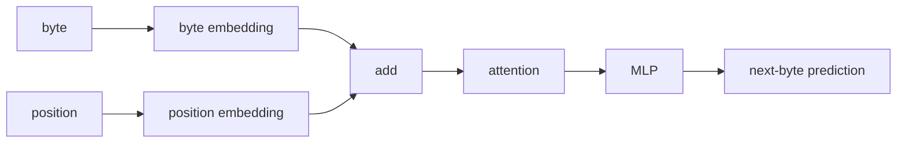
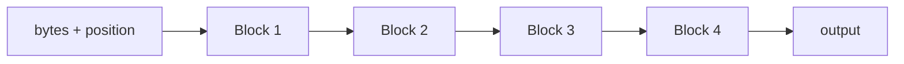

py -m venv .venv
.venv\Scripts\activate.ps1
pip install torch==2.13.0 --index-url https://download.pytorch.org/whl/cu132
pip install numpy
pip install datasets

#verify
python -c "import torch; print(torch.__version__); print(torch.version.cuda); print(torch.cuda.get_device_name(0)); print(torch.cuda.is_available())"

# design



use more transformers



# run

## simple recursion
```
This is a useful result.
Model	Params	VRAM	Time	Val loss
4 unique blocks	867,328	32.9 MB	140.9 s	1.2925
1 shared block ×4	272,512	23.0 MB	141.0 s	1.4159


So recurrence gave us:
- ~69% fewer parameters
- ~30% less VRAM
- essentially identical training speed
- only ~0.12 worse validation loss
That is actually promising.
```

## 2 blocks each used 2 times

```
So compared with 4 unique blocks, A→B→A→B uses about 46% fewer parameters and ~21% less VRAM, while validation loss only worsens from 1.2925 to 1.3403.

The repetitive generation is still a weakness, but that affects all these tiny models.
```

## 2 blockes each used 3 times

| Model | Params | VRAM | Time | Val loss |
|---|---:|---:|---:|---:|
| 4 unique blocks | 867k | 32.9 MB | 141 s | **1.2925** |
| A→B ×2 | 471k | 26.0 MB | 139 s | 1.3403 |
| **A→B ×3** | **471k** | **27.2 MB** | **195 s** | **1.3039** |
| A ×4 | 273k | 23.0 MB | 141 s | 1.4159 |

I wouldn't worry much about the repetitive generated text yet. We're using greedy argmax, only 64 bytes of context, and a ~0.5M parameter model.

## 2 blocks each 4 times

| Model | Params | Time | VRAM | Val loss |
|---|---:|---:|---:|---:|
| A→B ×3 | 470,784 | 194.8s | 27.2 MB | **1.3039** |
| A→B ×4 | 470,784 | 248.0s | 28.4 MB | 1.3072 |

## output


```
0: train loss=5.6593
2000: train loss=1.7291
4000: train loss=1.9288
6000: train loss=2.0501
8000: train loss=1.4713
10000: train loss=1.6772
12000: train loss=0.6984
14000: train loss=1.8523
16000: train loss=1.6198
18000: train loss=1.4691

Parameters:      470,784
Training time:   247.96s
Peak VRAM:       28.4 MB
Steps/sec:       80.7
Validation loss: 1.3072

Once upon a time, there was a little girl named Lily. They wanted to to the beach and said the man and said the because and said the because and said the because and said and she was so he was so happy. She was so ha
```
