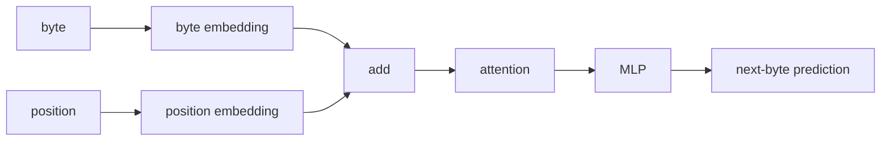
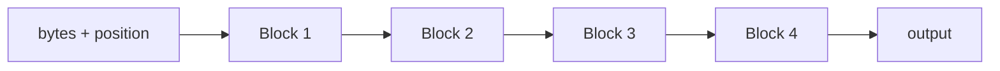

py -m venv .venv
.venv\Scripts\activate.ps1
pip install torch==2.13.0 --index-url https://download.pytorch.org/whl/cu132
pip install numpy
pip install datasets

#verify
python -c "import torch; print(torch.__version__); print(torch.version.cuda); print(torch.cuda.get_device_name(0)); print(torch.cuda.is_available())"

# design



use more transformers



# run

## simple recursion
```
This is a useful result.
Model	Params	VRAM	Time	Val loss
4 unique blocks	867,328	32.9 MB	140.9 s	1.2925
1 shared block ×4	272,512	23.0 MB	141.0 s	1.4159


So recurrence gave us:
- ~69% fewer parameters
- ~30% less VRAM
- essentially identical training speed
- only ~0.12 worse validation loss
That is actually promising.
```

## 2 blocks each used 2 times

```
So compared with 4 unique blocks, A→B→A→B uses about 46% fewer parameters and ~21% less VRAM, while validation loss only worsens from 1.2925 to 1.3403.

The repetitive generation is still a weakness, but that affects all these tiny models.
```

## 2 blockes each used 3 times

| Model | Params | VRAM | Time | Val loss |
|---|---:|---:|---:|---:|
| 4 unique blocks | 867k | 32.9 MB | 141 s | **1.2925** |
| A→B ×2 | 471k | 26.0 MB | 139 s | 1.3403 |
| **A→B ×3** | **471k** | **27.2 MB** | **195 s** | **1.3039** |
| A ×4 | 273k | 23.0 MB | 141 s | 1.4159 |

I wouldn't worry much about the repetitive generated text yet. We're using greedy argmax, only 64 bytes of context, and a ~0.5M parameter model.

## 2 blocks each 4 times

| Model | Params | Time | VRAM | Val loss |
|---|---:|---:|---:|---:|
| A→B ×3 | 470,784 | 194.8s | 27.2 MB | **1.3039** |
| A→B ×4 | 470,784 | 248.0s | 28.4 MB | 1.3072 |

# context=128 instead of 64

| Model | Context | Val loss | Time | VRAM |
|---|---:|---:|---:|---:|
| A→B ×3 | 64 | 1.3039 | 194.8s | 27.2 MB |
| A→B ×3 | 128 | **1.2649** | 189.7s | 31.8 MB |

# context=256 instead of 64

The next thing I’d test is context 256 before touching experts or anything more complex. This experiment strongly suggests the model is still context-limited.

| Context | Val loss | VRAM | Time |
|---:|---:|---:|---:|
| 64 | 1.3039 | 27.2 MB | 194.8s |
| 128 | **1.2649** | 31.8 MB | 189.7s |
| 256 | **1.2619** | 43.5 MB | 195.5s |

So 128 → 256 gives only 0.003 better loss but costs ~37% more VRAM.
I’d keep context 128 as the better efficiency point.

# context=128, dim=256, recurrent_steps=3

| Model | Params | VRAM | Val loss |
|---|---:|---:|---:|
| dim 128, ctx 128, A→B ×3 | 479k | 31.8 MB | 1.2649 |
| **dim 256, ctx 128, A→B ×3** | **1.74M** | **57.7 MB** | **1.1105** |

# context=128, dim=384, recurrent_steps=3

This is another clear gain.
| dim | Params | VRAM | Val loss |
|---:|---:|---:|---:|
| 128 | 479k | 31.8 MB | 1.2649 |
| 256 | 1.74M | 57.7 MB | 1.1105 |
| **384** | **3.80M** | **99 MB** | **1.0384** |


And the generated text is much more coherent now.
The important pattern so far:
Wider model capacity is buying much more quality than longer context or extra recurrent passes.

You still have enormous VRAM headroom, so I’d test dim=512, context=128, recurrent_steps=3 next.
That should tell us whether the gains continue or start flattening.

# context=128, dim=512, recurrent_steps=3

| dim | Params | VRAM | Val loss |
|---:|---:|---:|---:|
| 256 | 1.74M | 57.7 MB | 1.1105 |
| 384 | 3.80M | 99.0 MB | **1.0384** |
| 512 | 6.63M | 150.3 MB | **1.0321** |

# dim=384, context=128, recurrent_steps=2, blocks=3

| Design | Params | VRAM | Val loss |
|---|---:|---:|---:|
| 2 blocks ×3, dim 384 | 3.80M | 99 MB | 1.0384 |
| 3 blocks ×2, dim 384 | 5.57M | 126 MB | **1.0097** |
| 2 blocks ×3, dim 512 | 6.63M | 150 MB | 1.0321 |

So adding more unique blocks helped more than just increasing width.
The generation also looks cleaner.
That suggests our current bottleneck is more likely unique model capacity, not extra recurrent depth.

# dim=384, context=128, recurrent_steps=1, blocks=4

That gives only 4 block applications instead of 6, but more unique parameters. It will tell us whether recurrence is actually buying us anything at this scale.

| Design | Params | Block applications | Time | VRAM | Val loss |
|---|---:|---:|---:|---:|---:|
| 3 unique ×2 | 5.57M | 6 | 218.6s | 126 MB | **1.0097** |
| 4 unique ×1 | 7.34M | 4 | 173.3s | 158 MB | 1.0239 |

So the 3×2 model is:
- ~24% fewer parameters
- ~20% less VRAM
- slightly better validation loss
- but ~26% slower

For your RTX 3060, that trade is attractive because we have much more compute headroom than VRAM pressure.
I’d keep 3 unique blocks ×2 as our current baseline.
The next thing I’d change is probably the training setup rather than architecture: use a batch larger than 1. Right now each update learns from only one 128-byte sequence, which makes those training-loss numbers jump around a lot and wastes GPU parallelism.

## last tests output

Note: for more output see git history.

```
python main.py
0: train loss=5.6739
2000: train loss=1.7304
4000: train loss=1.7099
6000: train loss=1.7241
8000: train loss=1.4760
10000: train loss=1.2537
12000: train loss=1.3980
14000: train loss=1.8844
16000: train loss=1.2550
18000: train loss=0.9937

Parameters:      7,344,640
Training time:   173.28s
Peak VRAM:       158.0 MB
Steps/sec:       115.4
Validation loss: 1.0239

Once upon a time there was a little boy named Timmy. Timmy loved to play with her faces and saw a big box and said, "I will help your toys and she we have your best and she we have your best and she were some and she
```
