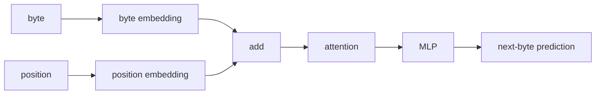
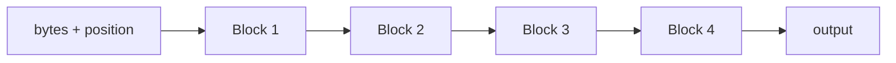

py -m venv .venv
.venv\Scripts\activate.ps1
pip install torch==2.13.0 --index-url https://download.pytorch.org/whl/cu132
pip install numpy
pip install datasets

#verify
python -c "import torch; print(torch.__version__); print(torch.version.cuda); print(torch.cuda.get_device_name(0)); print(torch.cuda.is_available())"

# design



use more transformers



# run

```
OLD:

Block A → Block B → Block C → Block D
different weights


NEW:

Block A → Block A → Block A → Block A
same weights
```

```
This is a useful result.
Model	Params	VRAM	Time	Val loss
4 unique blocks	867,328	32.9 MB	140.9 s	1.2925
1 shared block ×4	272,512	23.0 MB	141.0 s	1.4159


So recurrence gave us:
- ~69% fewer parameters
- ~30% less VRAM
- essentially identical training speed
- only ~0.12 worse validation loss
That is actually promising.
```


```
python main.py
0: train loss=5.5450
2000: train loss=2.3228
4000: train loss=1.8331
6000: train loss=2.1531
8000: train loss=1.4411
10000: train loss=2.2241
12000: train loss=1.6574
14000: train loss=1.6200
16000: train loss=1.2873
18000: train loss=1.3584

Parameters:      272,512
Training time:   141.00s
Peak VRAM:       23.0 MB
Steps/sec:       141.8
Validation loss: 1.4159

Once upon a time, there was and said the walked to the boar and her mom and her mom and her mom and her mom and her mom and her mom and her mom and her mom and her mom and her mom and her mom and her mom and her mom
```
